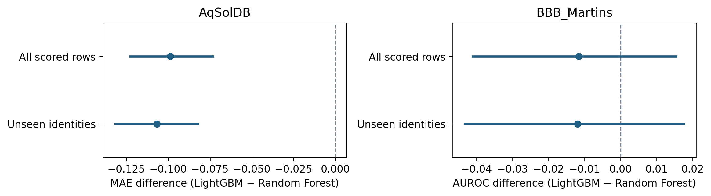

# Qsaria V1 for traceable molecular property modelling

## Abstract

Qsaria V1 provides a workflow for curating molecular data, training and evaluating QSAR models, and recording evidence for scientific reports. We describe its architecture and evaluate its LightGBM backend against Random Forest and naïve references on two public partitions from the Therapeutics Data Commons ADMET benchmark. For AqSolDB, the mean absolute error across three seeds was 1.279 log mol/L for LightGBM and 1.378 for Random Forest on 1,993 eligible test rows. On BBB_Martins, the mean area under the ROC curve was 0.865 for LightGBM and 0.856 for Random Forest on 406 test rows. The paired interval for the BBB_Martins difference at the prespecified reference seed included zero. The evaluation records standardized molecular identity overlap, data exclusions, and the provenance of the data, configuration, and predictions.

## Software and scope

Qsaria V1 originated in ChemSpace Copilot. It provides the shared toolkits for dataset curation, model training, inference, model registration, and reporting. The native QSAR team runs through Agno and Chainlit. The Qsaria MCP server exposes these operations under typed requests and records an experiment's artifacts and handoffs. A client can retrieve the evidence used to prepare the final report. Model selection, validation configuration, representation, and optimization are explicit request fields. The evaluated V1 revision requires an explicit request for hyperparameter optimization. [ChemSpace Copilot](https://github.com/Laboratoire-de-Chemoinformatique/chemspacecopilot) · [Qsaria](https://github.com/abrahambrisset/Qsaria)

The predictive study estimates performance for a fixed LightGBM configuration and comparable references. The workflow study checks whether the tool interfaces preserve the requested method and expose traceable evidence.

## Methods

We evaluated aqueous solubility on AqSolDB and binary blood–brain barrier permeability on BBB_Martins using the published development and test memberships in TDC ADMET archive `4426004`. Mean absolute error in log mol/L and AUROC were the respective primary metrics. We recorded the archive hash and dataset row numbers. The distributions and counts in this study refer to this exact archive. [TDC ADMET benchmark](https://tdcommons.ai/benchmark/admet_group/overview/) · [AqSolDB](https://doi.org/10.1038/s41597-019-0151-1) · [BBB_Martins](https://doi.org/10.1021/ci300124c)

Development validation grouped equivalent structures using Qsaria's standardized identity. For classification we used the first fold of five-fold stratified group cross-validation. For regression we used a group holdout targeting 20% of the groups. The final study preserved the archived test partition and fitted each model on the usable development rows. We report the full scored test cohort and a prespecified sensitivity analysis excluding test rows whose standardized identity occurred in the fit partition. Failed structure conversions were logged in the run. The script read final test structures for featurization and opened the final test labels for scoring after the model predictions for that dataset had been generated.

Both tree models used identical 2,048-bit Morgan fingerprints with radius two, 80 trees, one thread and fixed model settings. The LightGBM fit and prediction used the Qsaria V1 backend. Random Forest used scikit-learn's classifier or regressor. The naïve reference predicted the fitted mean for regression and used the fitted class prior for AUROC. The final analysis used model seeds 42, 1701, and 2026. The seed-to-seed standard deviation describes variability across these three fits. For seed 42 we computed a paired percentile interval from 1,000 bootstrap draws of standardized identities, retaining all rows for each sampled identity and applying the same draws to both models. The interval is conditional on the fitted models and this test set. The Qsaria strict bounding box was fitted only on development features and evaluated as an applicability diagnostic.

## Predictive results

| Dataset and cohort | Rows | Metric | Qsaria LightGBM | Random Forest | Naïve |
| --- | ---: | --- | ---: | ---: | ---: |
| AqSolDB, all scored | 1,993 | MAE | 1.279 ± 0.003 | 1.378 ± 0.005 | 1.853 |
| AqSolDB, unseen identities | 1,966 | MAE | 1.280 ± 0.003 | 1.387 ± 0.005 | 1.848 |
| BBB_Martins, all scored | 406 | AUROC | 0.865 ± 0.004 | 0.856 ± 0.015 | 0.500 |
| BBB_Martins, unseen identities | 403 | AUROC | 0.860 ± 0.004 | 0.850 ± 0.016 | 0.500 |

Table 1. Mean and sample standard deviation across three model seeds. The naïve predictions are invariant across seeds. Four of 1,997 AqSolDB test rows could not be featurized. There were 27 scored AqSolDB rows and three BBB_Martins rows whose standardized identities occurred in the respective fit partitions.

At seed 42, the paired difference between LightGBM and Random Forest on all scored AqSolDB rows was −0.099 MAE (95% interval −0.123 to −0.073). The difference on unseen identities was −0.107 (−0.132 to −0.081). On BBB_Martins, the paired difference at seed 42 was −0.012 AUROC (−0.041 to 0.016) on all scored rows. The direction of the difference at this seed and the uncertainty across molecules are relevant when interpreting the three-seed means.

Figure 1. The point is the paired difference for seed 42 and the line is its 95% identity-bootstrap interval. Each panel uses its own metric and scale. Negative differences favour LightGBM for MAE. Positive differences favour LightGBM for AUROC.

The bounding box classified all 1,993 scored AqSolDB rows as in-domain. On BBB_Martins, 397 rows were in-domain and nine were out-of-domain. The subgroup AUROCs at seed 42 were 0.864 and 0.850, respectively. The counts limit the evidence about performance outside the fitted box.

## Workflow verification

An installation check in an isolated Codex configuration verified plugin registration. An MCP stdio client initialized the Qsaria profile and listed 53 tools. A local functional check created an experiment and trained the V1 LightGBM backend with 40 synthetic structures, 12 trees and the optimization field omitted. The run produced prediction artifacts. This fixture uses a computed cLogP target and supplies functional evidence about the tool path.

We tested two equivalent requests for curation and lightweight LightGBM training in fresh GPT-6.1 Terra chats at high reasoning effort. Both accessed the actual Qsaria MCP server through a repository-local stdio bridge. Both preserved the requested CPU, `local_light`, binary Morgan, 12-estimator budget and disabled optimization and training outlier analysis. Each kept 40 rows after curation and produced four test predictions. The reported MAEs, 0.4340 and 1.0935, matched recomputation from the respective CSVs. Different effective seeds preclude interpreting the MAE difference as an effect of the wording. The coordinator initially attempted training before recording the curation handoff in both chats. The server enforced the handoff and both completed an authorized fit. One chat created a second experiment during recovery. The trials expose first-attempt sequencing and session-recovery issues. [Terra evidence](results/qsaria-v1/agentic.json)

A separate read-only test confirmed direct MCP use in Codex Desktop. With the local plugin installed and the repository root open as a project, a fresh GPT-6.1 Terra chat at high reasoning effort called `qsaria_bootstrap` and `qsaria_list_experiments` through the native integration. Bootstrap returned `ok` with the `qsaria` profile and server-side LLM use disabled. The experiment query completed and returned an empty list. [Native Codex test](results/qsaria-v1/agentic.json)

We also exercised the team instantiated by Chainlit against a scripted model transport. The real team delegated curation, training and reporting for the same fixture. It retained 40 rows and returned a test MAE of 0.884744, verified against four predictions. This test covers the Agno team and its tools with deterministic model responses. [Chainlit evidence](results/qsaria-v1/chainlit.json)

## Limitations

The predictive evaluation covers two archived endpoints and one fixed Qsaria learner. Its conclusions apply to these representations, comparator configurations, and partitions. Restricting evaluation to unseen standardized identities controls exact overlap under this definition. It allows closely related structures to occur on both sides. The applicability-domain result concerns a strict bounding box on binary fingerprints. It supplies a coverage diagnostic and the observed subgroup scores. Using three seeds on fixed test memberships leaves the effect of alternative dataset partitions unmeasured.

The workflow trials use one small synthetic fixture. Open-ended Chainlit interaction with an external model provider remains outside the coverage of the scripted trial.

## Code, data and reproduction

The predictive results refer to Qsaria V1 revision `1179b63d42eea5be044bdc041a0f12c35983019c`. The run manifest records the input hashes and library versions. The benchmark configuration, commands, aggregate results and figure are supplied with the manuscript. Replaying the benchmark produces row-level predictions tied to the source archive. [Reproduction guide](README.md) · [Run manifest](results/qsaria-v1/manifest.json)
